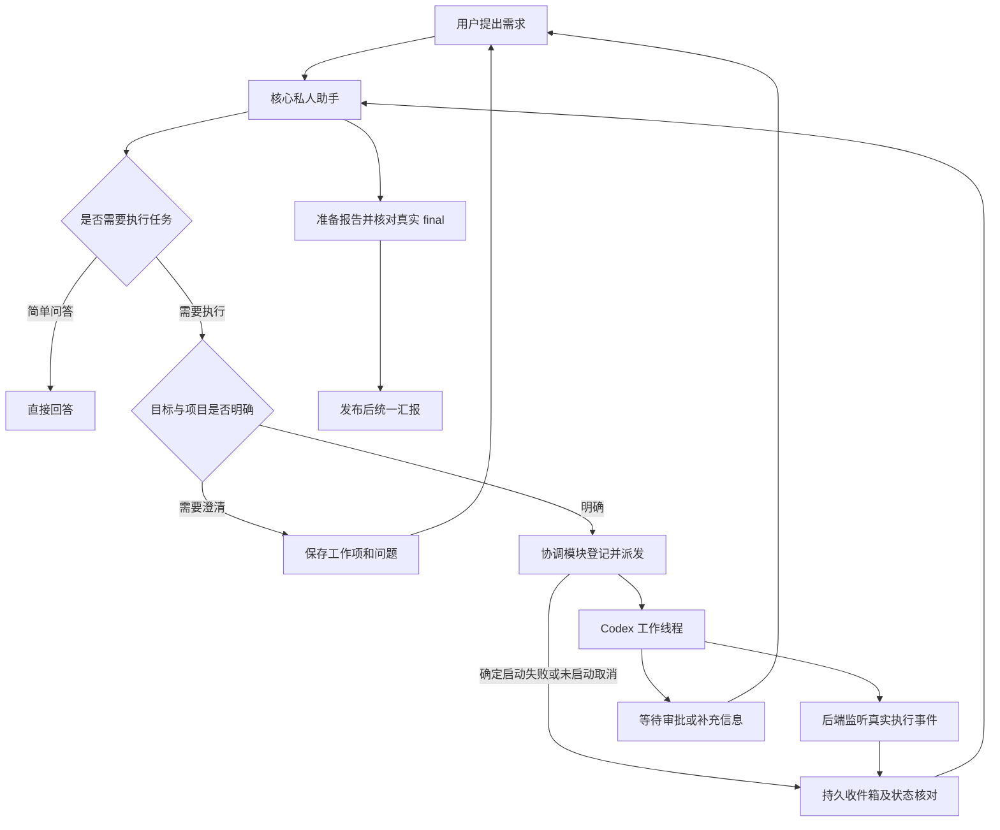

# CX-Codex 核心私人助手功能方案

日期：2026-10-13  
方案版本：0.3（完整设计参考，补齐执行链、澄清、启动失败与发布边界）  
状态：历史方案参考，尚未实现  
本轮范围：完善核心技能、接口契约、任务派发、结果回传、重启恢复与开发验收。用户明确要求先不写代码；本轮不创建实际技能、接口、数据库表或运行任务。

2026-10-13 轻量化调整：当前推荐的第一版以 [v0.4 轻量方案](PRD-CX-Codex-Personal-Assistant-Lite.md)为准。下文保留完整设计依据；其中同任务续办/修订、业务验收发布、批次与消费租约等机制不属于轻量第一版必做项。这是功能承诺的显式收缩，不改变 PRODUCT_GOAL.md 的既有门槛。

## 1. 摘要

在 CX-Codex 中提供一个具有固定身份的私人助手，统一接收用户需求。助手直接处理简单问答、整理与判断，把需要执行、持续工作或独立上下文的任务交给新的 Codex 线程，再收取结果、核对证据并向用户汇报。

“取代所有会话线程”在本方案中落实为：用户日常只与私人助手交流，不再手工创建、切换和盯着每个执行线程。后台继续使用原生 thread/turn 执行任务；用户需要时可以查看执行过程、审批、产物和失败原因。

本方案建议一个个人助手加一层受控任务派发，不建立角色市场、代理组织或无限递归调度。名称暂定“CX 助手”，可以配置。

第一版采用一个固定助手、一个主会话、一个托管执行槽位、一个核心技能包。技能负责工作方法，后端负责身份、权限、任务关系、持久收件箱和唤醒；Codex Runtime 继续负责实际执行。重试能保证稳定身份与本地发布幂等，不能承诺外部执行和用户通知在所有故障下恰好发生一次。

推荐按这个边界开发：用户需求及澄清共用一个稳定工作项；任务用版本化执行链连接每次执行；成功、失败、取消和需要信息都进入同一持久回传链路；内部汇总只有真实 final、执行终态和发布事务核对通过后才在统一入口展示。第一版不增加必装框架或外部数据库，不为每类职责各建一个技能或 Agent。

## 2. 参与者与职责

| 参与者 | 职责 | 边界 |
| --- | --- | --- |
| 用户 | 提出目标、补充信息、决定授权、查看结果 | 用户的指令和授权范围决定任务边界 |
| 核心私人助手 | 理解需求、简单任务直答、派发任务、追踪状态、核验与汇报 | 不因委派获得额外权限，不把长任务留在主会话阻塞后续交流 |
| 执行线程 | 在指定工作区执行明确任务，提供结果和验证证据 | 不能修改助手身份、冒充用户或任意控制其他任务 |
| CX-Codex 协调模块 | 保存身份与任务关系，落实派发策略，监听执行事件，保存和投递回报 | 是程序协调机制，复用现有 Runtime，不另建执行状态权威 |

## 3. 背景与已核查事实

用户希望有一个长期私人助手承担任务入口和跟进职责，减少多会话管理负担。现有 CX-Codex 已具备底层线程和恢复能力，但缺少把这些能力组织成私人助手的产品机制。

本轮核查的是当前源码及协议，不是生产 7420 的新功能验收。

| 能力 | 当前证据 | 对本功能的意义 |
| --- | --- | --- |
| 新建线程、启动任务 | `src/server/appServerRuntimeStart.ts:178` 创建 thread，随后通过 `turn/start` 执行；`runtimeActionRoutes.ts:89` 是可靠发送入口 | 复用可靠发送链路，不用助手直接裸转发写入 RPC |
| 请求身份与幂等 | `appServerRuntimeStart.ts:68`、`:136`；`runtimeStore.ts:1448` | 可复用稳定请求 ID、`clientMessageId` 与正文哈希校验 |
| 本地持久化 | `runtimeStore.ts:366` 中的 SQLite/WAL，以及请求、事件、快照、租约 | 身份、任务关系和收件箱可使用现有数据库；当前没有这些助手专属表 |
| 执行事件与恢复 | `codexAppServerBridge.ts:127`、`appServerNotificationRuntimeSync.ts:57`；Runtime replay 与 reconciliation | 可以在后端监听任务，网页不必保持打开 |
| 线程队列 | `runtimeMessageQueue.ts:127`、`:243` | 主助手忙碌时可以持久排队，但要区分用户消息与内部回报 |
| 审批与补充输入 | `appServerServerRequestHandler.ts:85`、`serverRequestRoutes.ts:19` | 汇总到助手入口，仍回应原始请求；不能用机器人自动批准替代 |
| 原生目标 | `src/api/codexGateway.ts:1056` | 管理单线程目标，不提供助手任务父子关系或跨线程收件箱 |
| 工具执行缺口 | `serverRequestPolicy.ts:147` 对所有 `item/tool/call` 返回失败；`appServerServerRequestHandler.ts:50` 执行该策略 | 必须新增受控的服务端工具处理器；仅改提示词不能派发任务 |
| 身份与工具注册缺口 | `runtimePayload.ts:157`、`appServerRuntimeStart.ts:329` 未提供助手身份及 `dynamicTools` 扩展 | 需要服务端构造助手配置，不能接受前端任意工具定义 |

需要特别保留的事实：

- `PROJECT_SPEC.md:37` 明确 App Server 与 Runtime snapshots 是执行状态权威；新的任务记录只负责协调关系、业务验收与报告投递。
- `runtimeMessageQueue.ts:277` 的请求 `completed` 可能表示原生队列交接，不能据此宣布任务做完。
- `runtimeStore.ts:173` 的事件保留有上限，约 5000 条；永久依赖 replay 游标会漏报，需要持久收件箱及快照补偿。
- `pendingServerRequests.ts:22` 当前使用内存 Map。任务记录可以保存“等待审批”的引用，但不能据此宣称原审批请求已跨重启持久化。

本轮进一步核查到三个必须纳入开发的缺口：

| 已核查事实 | 当前源码 | 对方案的约束 |
| --- | --- | --- |
| thread/start 返回后才保存 threadId；没有 threadId 的超时可能落入 failed | `appServerRuntimeStart.ts:178-188`、`:230-246`、`:291-301` | failed 不一定证明线程未创建；增加 RPC 发出前的持久阶段，未知结果不能自动重建 |
| pending_start 恢复检查身份和正文哈希，没有检查 RPC 是否可能已经发出 | `appServerRuntimeRequestReconciliation.ts:115-123` | 助手表单独去重不足以保护现有 Runtime 自动恢复，必须同时补 Runtime 发送阶段 |
| interrupt 的成功响应会先更新本地 stopped | `appServerRuntimeInterrupt.ts:58`、`:111-125` | 更正任务的放行需要对应实际 turn 的终态/停止证据，不能仅看本地停止回执 |

### 3.1 外部设计依据与采用范围

完整核查记录见 [GitHub 调研](research-CX-Codex-personal-assistant-github-20261013.md)。下面采用的是固定提交的设计机制，不安装这些产品，不把其 main 源码能力推断为本机现有能力。

| 来源 | 本方案采用 | 本方案调整 |
| --- | --- | --- |
| [AO 的报告协调器](https://github.com/OrchestratorInc/agent-orchestrator/blob/4a499e8d5e4678d5e3ee098bd797c608291b73d5/backend/internal/service/report/coordinator.go)及[入口技能](https://github.com/OrchestratorInc/agent-orchestrator/blob/4a499e8d5e4678d5e3ee098bd797c608291b73d5/backend/internal/skillassets/using-ao/SKILL.md) | 主协调者/worker 分工、短受理回执、持久回报、领取/确认、按需技能文档 | 保留 CX Runtime；私人助手使用短合并窗口，不沿用 AO 的一小时/五分钟等待策略 |
| [OpenClaw 的 Codex 生命周期](https://github.com/openclaw/openclaw/blob/c15fe88ece42366cc68cb6d9ef92b597593fa529/extensions/codex/src/app-server/thread-lifecycle-io.ts)及[子会话交付](https://github.com/openclaw/openclaw/blob/c15fe88ece42366cc68cb6d9ef92b597593fa529/src/agents/subagents/registry/subagent-registry-lifecycle-delivery.ts) | 真实 thread/turn 绑定、受控动态工具、父助手审核、交付状态分开记录 | 不引入其 Gateway/插件运行体系；不混同 native 子会话、ACP 和 Codex 原生线程三条路径 |
| [Hermes 的异步委派](https://github.com/NousResearch/hermes-agent/blob/63d0b94120027d487c9a5235b9ec64b696af1b26/tools/async_delegation.py)及[身份文件](https://github.com/NousResearch/hermes-agent/blob/63d0b94120027d487c9a5235b9ec64b696af1b26/SOUL.md) | 身份独立于聊天、结果先落盘再通知、失败释放、重启补发、unknown 不盲目重跑 | worker 继续运行 Codex；不新增另一套 Python Agent Runtime |

官方新版本已有子代理与消息板，但当前源码的终态回报仍为尽力投递、未去重，自动回报不启动闲置根助手的新回合。内部 AgentControl 也不是任意用户线程的公共协调协议，因此第一版保留 CX 的持久 inbox 和宿主唤醒调度。详见调研的官方能力章节；不把开发中的扩展设为必需依赖。

协议核查：官方 [Codex App Server 文档](https://learn.chatgpt.com/docs/app-server)说明了线程、轮次、事件及客户端动态工具；`dynamicTools` 和 `item/tool/call` 属实验接口。当前初始化代码已默认开启 `experimentalApi`，缺口是注册、执行与授权校验。

本轮显式调用的 CLI 为 `codex-cli 0.130.0`。其 `generate-json-schema --experimental` 成功生成协议，确认包含 `thread/start.dynamicTools`、`developerInstructions`，工具请求包含 `threadId/turnId/callId/tool/arguments`，回应包含 `success/contentItems`。该探针不是正在运行的 7420 CLI 身份证明，也没有执行真实工具调用。该 CLI 的 `TurnStartParams` 没有最新官方文档中的独立 `toolOutput` 字段，方案不能直接依赖它。

## 4. 目标与验收结果

核心目标是让用户把注意力放在需求和结果上，由助手承担任务管理，同时保持 CX-Codex 的轻量、安全与恢复能力。

第一版必须达到以下可验证结果：

1. 用户从助手入口提交简单问答，直接获得回答，不创建工作线程。
2. 对需要执行的任务，助手创建有目标、工作区、验收条件和稳定身份的任务；重试同一派发不重复启动真实执行。
3. 助手派发后可以继续接收其他需求，不同步等待工作线程全部完成。
4. 任务结束、失败或需要输入时，回报进入持久收件箱；页面关闭后仍能保存，恢复页面后能看到。
5. 只有核对执行终态、结果出处和验收证据后，才标记为“已完成”；“执行结束”与“目标达成”分开。
6. 重复事件、服务重启和助手忙碌不导致重复派发、结果丢失或旧结果覆盖新要求。
7. 原审批、工作区和消息权限边界不因助手入口改变。

沿用当前产品的反馈预算：本地输入/受理反馈目标 100 ms 内；模型响应、工作线程执行和系统离线时长另外记录，不能混算为即时反馈。

## 5. 用户场景与范围

适用用户仍是已经在本机运行 Codex 的个人开发者和高级用户。

优先覆盖四种场景：

- “这段报错是什么意思？”——助手直接解释；需要查源码或执行命令时再派发。
- “帮我修复这个页面，并确认手机上能正常使用。”——助手整理验收条件，在相应项目创建工作线程，完成后回报修改、产物与检查。
- “刚才那个任务进展怎样？”——助手读取绑定任务的真实状态，不凭聊天印象猜测。
- “停掉任务 A；任务 B 改成只分析不修改。”——助手定位任务，传达取消或修订，保留实际生效状态和旧版本证据。

第一版包括固定身份、主助手会话、受控派发、任务列表、持久收件箱、统一回报、审批/补充输入入口、取消/更正和异常恢复。一个执行任务对应一个工作线程，可在同一线程续办；第一版采用保守串行派发，不承诺同时跑多个写任务。

长期可逐步接管日常新任务入口，并支持经用户指定把现有线程纳入管理。第一版不自动认领历史全部会话，也不归档或删除它们。

范围依据：`PRODUCT_GOAL.md:124` 排除了多智能体组织系统，并要求范围外建议先评审。本方案是用户此次提出的个人助手扩展草案，不自动改写稳态目标、不关闭原有门槛、不构成实现或发布授权。后续实现前需要在产品路线中明确这项扩展的位置。

## 6. 用户价值

| 当前用户工作 | 使用助手后的变化 |
| --- | --- |
| 为每件事创建并寻找会话 | 向同一个助手提出需求，由任务记录关联执行线程 |
| 在多个线程中检查进展 | 在助手入口查看进行中、等待处理和已回报任务 |
| 手工把结果从一个线程复制到另一个线程 | 后端保存有出处的结果，由助手核验并汇总 |
| 长会话保存全部角色、偏好与任务细节 | 身份资料、明确偏好、任务事实独立保存，会话可以压缩或更换 |
| 看到“结束”但不知道是否完成目标 | 回报明确说明做了什么、验证了什么、还有什么没完成 |

不假设这个功能会提高模型本身的正确率。价值来自减少用户管理成本，并使任务和结果可追踪。

## 7. 解决方案

### 7.0 推荐定案

| 决定 | 第一版做法 | 理由 |
| --- | --- | --- |
| 入口与身份 | 一个私人助手、一个主会话；身份与任务事实独立保存 | 更换会话不会失去助手身份和任务关系 |
| 核心技能 | 一个短入口技能，加按需参考与 worker brief | 核心方法统一，避免技能重复和主上下文膨胀 |
| 需求来源 | 工作项记录真实用户来源链及问题/答案 | 跨 turn 澄清保留目标与授权，答复不误建新任务 |
| 派发 | 一层 worker、一个可能运行的执行槽位，共用 Runtime | 主助手可继续问答，控制写入与恢复复杂度 |
| 当前完成 | 版本化执行链 + 当前所需执行的最新证据 | 旧 attempt 成功不能覆盖已经开始的续办 |
| 回传 | 后端 durable inbox；worker 声明只是材料之一 | 页面关闭、worker 未交报告或启动失败都能保存结果 |
| 发布 | prepare → 匹配的原生 final 与父成功终态 → publication/ACK | 保留真实原生回复语义，不靠模型文字结算完成 |
| 恢复 | 用原身份对账；补收件、补发布；未知执行暂停 | 不把重复执行当成恢复办法 |

核心业务链路如下；这是计划数据关系，不代表已经实现：

```text
用户需求 + 经确认的澄清答案
  → 同一个 workItem（sourceVersion）
  → task（revision + executionChainVersion）
  → obligation / attempt（稳定发送身份 + Runtime 发送阶段）
  → 实际 Codex thread / turn，或有证据的未启动结果
  → inbox → wakeBatch / summaryAttempt → prepare
  → 匹配的真实 final + 父回合成功终态
  → publication + covered inbox ACK → 同一会话投影展示
```

协调器只连接这些事实，不重新实现 Codex 执行器。工作项和澄清问题、执行义务、收件项分别有自己的来源与版本，但都保存在现有本地 SQLite，不拆成独立服务。

### 7.1 用户流程与界面



助手成为默认工作入口，主界面显示固定名称与对话。旁边按需展开任务列表；移动端使用已有抽屉或 sheet 模式，避免增加永久栏。

任务行只显示标题、项目和一个主要状态；需要用户处理的事项优先呈现。点开任务可以看目标、验收条件、产物、检查、未完成项以及原执行线程。

统一回报示例：

> 页面修改已完成，整体任务待验证：调整了输入区间距，前端构建和手机尺寸回归通过。你要求的真实 Android 设备验证尚未完成，因此任务显示“未完成”；可以查看改动和执行记录。

失败示例：

> 任务暂停在依赖安装：网络请求失败，尚未修改源码。需要恢复网络后继续；当前不能报告修复完成。

继续沿用现有单一 `conversation-transcript` 投影和 Sema 会话语义。任务摘要是协调数据；对话的 final、活动、审批、耗时和文件变化不能另造一套推断规则。内部汇总有可信来源与发布门槛，具体见 7.5.4；普通用户问答继续使用原生流式回复。

### 7.2 身份、记忆与主会话

助手拥有稳定的 `assistantId`，配置包括名称、职责、表达偏好、允许访问的项目以及当前 `coordinatorThreadId`。身份与具体线程 ID 分开：更换或压缩主会话后，助手仍是同一个助手。

身份指令由后端构造并绑定版本，通过本机已核查的 `developerInstructions` 等受支持字段传入；不覆盖 Codex 基础指令，不把前端文本当高权限指令。

绑定资料增加 `bindingVersion`，协调消费者增加 `coordinatorGeneration/ownerInstanceId`。更换主会话递增 bindingVersion；消费者接管递增 generation。实例身份包含启动随机 ID，不只使用 PID。身份、技能和工具包分别版本化，变更不能悄悄改变已经运行的执行任务。

信息分三类保存：

| 类型 | 保存规则 |
| --- | --- |
| 身份资料 | 用户可查看、修改，长期保留 |
| 用户明确确认的偏好 | 记录来源，支持更正与删除；“以后默认……”才进入偏好 |
| 工作事实 | 任务目标、状态出处、产物和检查，有界索引与按需读取；不自动提升为长期偏好 |

不把所有线程日志注入主助手上下文。每次处理只读取当前需求、必要偏好和相关任务摘要；原始结果按需查看。

归档、丢失或重绑定主会话时暂停未确认回报，先对账再显式迁移绑定，不能自动把旧批次投给任意新会话。第一版可以提供“重建助手会话”恢复操作，保留原身份、任务与未消费回报。

### 7.2.1 核心技能包

实现阶段提供一个 `cxcodex-assistant-core`，加一份执行线程交付模板。以下仅为计划目录，本轮不实际创建这些资产：

```text
cxcodex-assistant-core/
  SKILL.md
  references/
    routing-and-dispatch.md
    reports-and-evidence.md
    task-control.md
    recovery.md
  templates/
    worker-brief.md
  schemas/
    task-request.v1.json
    worker-report.v1.json
```

| 资产 | 内容 |
| --- | --- |
| SKILL.md | 判断直答或派发；使用已登记工作项；派发受理后结束主回合；读取真实任务状态；审核回报；未知状态先对账。建议约 60–80 行，避免装入全部异常细则 |
| routing-and-dispatch | 路由标准、工作项与澄清来源链、工作区、授权与验收、稳定身份、串行执行、技能选择 |
| reports-and-evidence | worker 结构化回报、证据层级、prepare/final/发布边界、未验证项 |
| task-control | 澄清问答、followup/revise/cancel 的区别，执行链、生效条件和版本冲突 |
| recovery | 模型收到“状态待核对”时如何解释和查询；实际重启恢复由程序执行 |
| worker-brief | 本次目标、输入材料、验收、允许动作、禁止事项、交付格式和任务绑定 |
| schemas | 任务请求和 worker 回报格式；后端独立校验，不能只依赖模型读过格式 |

技能不写死助手名称、项目偏好、任务列表或当前进度。主会话每次只加载核心入口与必要参考；工作线程只拿本次 brief 和需要的领域技能，不自动获得核心协调职责。

发布包记录 `coreSkillVersion/assetHash/toolkitVersion/reportSchemaVersion`；由服务端选取受信任资产，不接受前端任意技能路径，不改用户全局 CODEX_HOME。现有 skill 输入能否使用包内路径属于 P0 探针，不预先假设 skills/list 已有助手隔离能力。

派发时冻结目标、授权、验收和模板版本，记录选用领域技能的版本/指纹。包内核心资产采用版本化路径；可变领域技能若内容变化，续办要重新核验并记录差异，不能宣称已经拥有无法验证的内容冻结能力。更换主工具集不能在旧线程可靠生效时，新建主会话并迁移绑定。

技能文件缺失、hash 不符或工具包不兼容时，暂停托管派发，保留聊天和任务读取入口，明确显示能力不可用，不悄悄改成无法追踪的执行。

### 7.3 任务路由与执行边界

简单任务是可以在一个短回合中完成的问答、改写、已有材料整理或任务状态查询。需要修改文件、运行工具、读取较多材料、多步骤研究或持续等待的任务进入工作线程。

模型提出派发意图，后端核验工作区、动作范围、用户授权与任务身份。涉及哪个项目确实不明确时再向用户提问，不能凭相同模块名猜工作区。

派发工具在任务持久受理后立即返回任务 ID 和当前派发状态；有线程 ID 时一并返回。不能等工作完成才回应工具，也不能返回“已完成”冒充实际结果。

第一版：助手主回合始终串行；执行任务先按 FIFO 串行派发。取消和更正可以调整待执行任务。后续只有在补齐独立工作区与恢复验收后才开放可控并行。

默认最多一个托管执行尝试处于可能运行状态；未知启动或停止也占用该槽位，不能因消费者租约过期就让下一项写任务开始。主助手仍可回答和查看任务。第一版不支持 worker 递归创建托管任务。

至少以解析后的真实工作区路径限制托管写任务的并发；同一工作区禁止两个托管写任务同时执行。该约束不能自动管住官方桌面端或其他进程的外部写入，检测到已知外部执行时需等待或提示；未验证工作区独占能力前不能宣称隔离已保证。

主助手使用尽量小的权限范围，写任务进入工作线程的受限 sandbox。主助手工具/原生协作能力能否按线程约束，必须在协议验证中确认；不能仅凭提示词声称已经禁止绕过调度。协调层第一版只派发一层任务。

### 7.3.1 任务身份与派发事务

| 身份 | 含义 | 重试/续办规则 |
| --- | --- | --- |
| sourceUserRequestId/sourceRefs | 服务端已受理的原需求及经认证的澄清消息 | 新需求有新来源；澄清答案追加到指定工作项，模型不得自造 |
| workItemId/sourceVersion/taskId | 稳定工作项、来源链版本/真正派发受理后的业务任务 | 跨 turn 澄清不换工作项；派发前冻结来源，简单问答不启动 worker |
| revision | 目标、验收与允许动作的一版契约 | substantive revise 递增；同范围 followup 不改变原契约 |
| executionChainVersion/obligationId | 当前 revision 必需执行义务集合及其绑定版本 | 追加、撤销、替换义务或绑定新 attempt 时递增；不代替 Runtime 执行状态 |
| attemptId | 一次实际执行提交 | 传输重投保持不变；真正续办/重新执行才新建 |
| requestId/clientMessageId | attempt 对应的 Runtime 受理/发送身份 | 服务端生成并持久保存，不在恢复时换 ID |
| threadId/turnId/runtimeGeneration | 实际原生执行绑定 | 来自可靠回执或精确对账；未知时为空，不猜测 |
| callId | 一次工具投递身份 | 不代替 task/attempt 业务身份 |

一条派发意图的不可变内容包括工作项来源链/版本、执行义务、解析后的工作区、目标、验收、输入引用、允许动作、有效权限及模板/技能版本；由后端规范化并计算 dispatchHash。复用现有正文去重，同时补齐助手完整契约校验。新答案或控制不改写旧 attempt 的冻结快照；新执行尝试记录其自己的授权来源。

派发按以下顺序进行，任何数据库事务都不跨越 RPC：

1. 用户消息先进入现有 durable outbox/Runtime 受理链路，后端登记工作项引用。来源消息进入哪个实际主 turn，必须有可验证的原生消息身份和执行事实；队列已受理不表示已进入该 turn。可用来源集合包含本 turn 的实际用户消息，以及后端通过该消息明确关联的 pending 工作项原需求/澄清链；不能把聊天上下文里任意旧消息都作为授权。多个消息若被原生协议纳入同一 turn，工具也只能引用该获准集合，不能把“一个 turn”误当“一个用户请求”。实际 turn 若属于其他执行或无法精确关联，保持待核对，不认领、不结算、不擅自中断；相关 steer 路径在 P0 未证明前不开放。
2. 主助手提出目标和动作意图。后端校验工作项及 expectedSourceVersion、来源链、项目、用户授权、schema 与期望版本，在一个 SQLite 事务写 task revision、初始 obligation/attempt、executionChainVersion、不可变派发快照和 dispatch intent；唯一约束防止重复受理。
3. 事务提交后立即返回 accepted 回执，线程 ID 可以尚不存在。相同身份与相同 hash 重投返回原回执；不同 hash 返回冲突，不能覆盖正在执行的契约。
4. 调度器在有效占用下领取 intent，重新检查取消/更正、当前 revision 与执行槽位，调用 Runtime 内部可靠入口。它与 HTTP runtime/send 共用受理服务，不额外绕一圈本机网络，也不直接调用裸 RPC。
5. Runtime 先持久受理请求，再执行原生操作。交接回执丢失时用原 clientMessageId 查回请求；助手记录补上关联，不分配新 attempt。
6. RPC 的晚到回执可以补齐原 threadId/turnId。继续执行下一步前必须重查任务版本、取消意图及调度 generation，旧回调不能启动已撤销的目标。

### 7.3.1.1 工作项与多轮澄清

用户提出独立需求时，以原始 sourceUserRequestId 预留稳定 workItem。主助手发现项目、材料或目标不明，通过方案中的 `assistant_update_task` 的 request_clarification 动作，把问题持久绑定到 workItem；此时没有 task、attempt 或 worker。该工具支持 workItemRef/taskId 两种明确目标，不另增一套协调工具。

工作项状态为 reserved、awaiting_clarification、ready、task_bound、withdrawn/not_task。简单问答的预留引用不显示成执行任务；已经明确是某问题答复的消息关联原 workItem，不生成第二个执行工作项。

工作项保存原需求、sourceRefs、sourceVersion、问题与答案出处。补充答案递增 sourceVersion；派发必须引用原 workItem 和 expectedSourceVersion，受理后固定绑定唯一 task。来源版本变化发生在派发前不创建执行修订；任务已派发后改变契约才走 revise。

例如“帮我修页面” → “哪个项目？” → “项目 A”：首条需求提供目标和原授权，第二条真实用户消息补齐项目；本 turn 经后端登记可以使用这一条受控来源链，派发仍用首条工作项。worker 材料、内部 wake 或仅在聊天历史出现的文本不能进入用户授权链。多项需求/问题无法定位时先澄清，不能仅因为“目前只有一个待答问题”就把新需求当成答案。

### 7.3.1.2 执行链与当前完成判据

执行链只保存“本任务还需要哪些执行，以及它们绑定哪个 attempt”。新增、替换、撤销义务，或将 pending 义务绑定新 attempt 时，以 CAS 递增 executionChainVersion；实际是否开始、运行、终止仍来自 Runtime。

followup 受理事务立即建立 pending obligation，即使 A2 尚未创建也阻止当前任务 completed。原 attempt 权威终态后，调度器建立新 attempt、绑定该义务，更新 latestRequiredAttemptId 和链版本。activeAttemptId 指可能运行或启动/停止未知的尝试，只在权威终态或确证未执行后清除。

结算 completed 必须满足：当前 desiredRevision 和执行链版本有效；没有未绑定、pending、queued、active 或 uncertain 的必需义务；最后所需 attempt 已有权威终态、当前有效验收证据全部满足；没有待生效控制；与当前执行链对应的结论已发布。以前失败的尝试保留历史；经明确续办/重试替代后，不要求旧失败尝试也成功。

A1 成功后 A2 续办时，A1 报告可以标明“上一次执行结果”，但不能驱动当前任务完成。prepare 保存 executionChainVersion、latestRequiredAttemptId 和证据版本；publication 再做 CAS。执行链变化后原 prepare 不再结算当前状态，重新核对或按原汇总预算补办，不重新执行 worker。

追加 followup 只改变“还需哪些执行”，不撤销合法的 A1。派发下一 RPC 前读取当前版本、义务是否仍有效及取消/修订意图；不能仅因链版本增加就停止原尝试，也不能无条件沿旧版本继续。当前完成结算使用最新链版本；每个 attempt 保留创建时的冻结契约。obligation 可复用待执行 intent 的存储记录，不建设 DAG、任务依赖引擎或第二套运行状态。

### 7.3.2 RPC 发出前的持久阶段

这些发送事实必须纳入 Runtime 请求及其恢复判据，不只存在助手表：

```text
accepted
  → thread_rpc_may_have_started
  → thread_bound
  → turn_rpc_may_have_started
  → turn_bound
```

复用线程时跳过 thread/start 两步。现有 Runtime 终态仍决定执行是否结束；这些阶段只说明发送事实。

调用 thread/start 或 turn/start 前先提交 may_have_started 阶段。门闩落盘后即使进程在真正发送前崩溃，也保守视为可能已发送；只有阶段证明未进入对应发送路径时，才允许自动提交。取消、更正和所有后台恢复路径必须读取同一门闩。

thread/start 可能成功、threadId 未知时进入 dispatch_uncertain，禁止自动重建线程或启动替代执行。不能按标题、cwd、时间或“最近新增线程”自动认领。P0 若证明目标协议支持可读、持久、唯一的相关身份，才增加自动绑定；否则提供待核对入口，承认这个窗口不能自动恢复。

### 7.4 服务端工具与接口草案

工具注册只由后端提供，限定助手所属线程；以下名称是新接口草案，不代表已有实现：

| 工具 | 输入重点 | 返回/行为 |
| --- | --- | --- |
| `assistant_dispatch_task` | workItemRef、expectedSourceVersion、任务描述、项目引用、目标、验收条件 | 后端绑定稳定工作项；持久受理后复用 `runtime/send` 创建/执行工作线程 |
| `assistant_read_tasks` | 任务/工作项 ID 或有界过滤 | 任务与执行链、Runtime 状态、待澄清工作项、有效问题和结果出处 |
| `assistant_update_task` | workItemRef/taskId 二选一、对应期望版本、动作及真实用户来源 | 执行动作 followup/revise/cancel；工作项问答 request_clarification/answer。共用校验及事务，不新增通用派发工具 |
| `assistant_prepare_report` | 当前批次、coveredInboxIds、结构化结论和证据引用 | 核验归属与版本，准备 canonical report 和发布预览；不单凭文字把执行标为成功 |
| `assistant_submit_task_report` | worker 的结构化终态声明、验收条目、证据及未完成项 | 仅向当前绑定执行尝试持久提交材料，返回 claimId；不修改任务终态、不直接发消息给父助手 |

前四项只注册给主助手，第五项只注册给托管 worker。普通线程没有助手专用工具。注册和逐次调用校验都由后端落实，技能里的 allowed tools 说明不构成权限隔离。worker 不具备派发、修改助手、消费父 inbox 或控制其他任务的能力。

服务端校验 `threadId/turnId/callId`、工具名、参数结构、助手归属、任务归属、项目范围与任务版本。未知工具继续走现有拒绝路径；不提供通用 raw RPC、任意 shell 执行或批准工具。

同时校验当前连接实例、bindingVersion、工具包版本和来源授权记录。执行控制引用本次用户要求及 expectedRevision/expectedControlVersion；未派发 workItem 的澄清答复校验 expectedSourceVersion，已派发 task 的答复校验 expectedRevision/expectedControlVersion，并核验对应问题与执行链仍有效。内部回报唤醒和 worker 内容不能被当成扩大授权的用户请求。

主助手调用校验当前主会话绑定；worker 交付校验其 attempt 冻结的角色、工具版本和实际执行绑定。更换主会话不授予旧 worker 新权限，也不阻止它给原 attempt 保存材料；旧连接的工具回执仍不能跨连接重放。

第一版每条独立执行需求对应一个主工作项；一句话中的关联步骤放在同一任务内，暂不自动拆成多个独立工作项。后端以 `assistantId/原始sourceUserRequestId` 预留唯一工作项身份；已关联问题的答案并入该项，简单问答不会因此创建 worker。工具只引用服务端已登记的来源链及其获准版本，不能由模型自造来源或工作项。

派发去重以 workItemId 为业务身份，以实际 `callId` 为一次工具投递身份。派发前澄清用 sourceVersion CAS；受理后相同工作项、相同冻结契约重投返回原回执，不同契约必须显式修订。用户明确提出第二个同内容任务时，新需求对应新工作项，不能按正文误合并。未来一条需求拆成多个工作项时，先新增服务端计划版本与稳定分项登记契约，再开放自动拆分。

建议新增路由：读取/修改助手资料、获取主会话绑定、提交用户消息、分页读取任务和已发布报告。用户消息进入既有 durable outbox/Runtime 接受链路；任务更新与审批回应复用现有授权检查。接口不接收客户端提供的任意 `dynamicTools`、审批策略或执行权限。

### 7.4.1 请求、回报与接口契约

| 数据 | 第一版字段 | 规则 |
| --- | --- | --- |
| 派发请求 | schemaVersion、workItemRef、expectedSourceVersion、projectRef、goal、acceptanceCriteria（criterionId/text）、requestedActions、constraints、inputRefs、skillRefs | 模型提出意图；来源链由后端读取，实际路径、权限与有效技能由后端决定；第一版所有登记验收项均为必需，不隐式挑选“必须项” |
| accepted 回执 | taskId、revision、executionChainVersion、obligationId、attemptId、dispatchState、可选 threadId | 表示已持久受理；不表示已经执行、做完或派发一定成功 |
| worker 声明 | schemaVersion、outcomeClaim、summary、criteria、artifacts、checks、evidenceRefs、remaining | 终态声明 success/partial/blocked/failed；不允许模型自行结算 cancelled |
| 准备报告 | wakeBatchId、coveredInboxIds、每项 task/revision、expectedExecutionChainVersion、报告 scope=current/historical、关联 attempt、resolution、criterionAssessments、evidenceRefs、checks、limitations、nextAction；needs_input 还提供 waitingKind 与有效请求引用或明确补充问题 | 只能处理本批有效成员；范围和版本由后端校验，历史报告不结算当前任务 |
| prepare 回执 | prepareId、canonicalReportHash、publicationPreview、previewHash | 服务端校验后的规范报告与可发布正文；主助手 final 应使用该预览 |
| 澄清问答 | workItemRef/taskId、questionId、answerId、真实 sourceUserRequestId、expectedSourceVersion 或 expectedRevision/expectedControlVersion、继续方式 | 未派发 workItem 校验来源版本；已派发 task 校验任务与控制版本，以及问题和执行链有效性。同一答复一次受理，关联原问题；答案和工作项更新/执行义务与关闭问题原子保存，见 7.4.2 |

worker 的 task/revision/attempt/实际 turn/callId 从工具调用绑定补入，不能接受模型伪造。相同终态声明重投返回原 claimId；同一声明身份与不同正文返回冲突。第一版不提供高频自由进度消息；审批和补充输入继续使用原生请求，后端立即呈现。

证据引用使用受控的 native item、Runtime 记录、源码位置和授权产物引用。后端能核对出处、实际检查退出码、文件存在和身份，不能把 worker 自述的“exitCode=0”当作检查证据，也不能证明模型对业务内容的判断绝对正确。纯模型判断和源码推断标为 reviewed/inferred；设备、部署或真实交付要求没有相应证据时为 unverified。

建议的产品接口均为新设计：

| 路由职责 | 输入边界 | 行为 |
| --- | --- | --- |
| 读取/更新助手资料与绑定 | 已认证用户、期望 profileVersion/bindingVersion | 修改固定身份；绑定变更先暂停旧批次再对账 |
| 助手用户消息 | clientMessageId、正文、项目/材料引用；答复可带 replyToQuestionId/answerId 与期望版本 | 复用可靠接受链路，登记来源；验证问题归属后持久保存答复意图；不接受客户端 system origin |
| 分页读取任务与报告 | 有界游标、所属 assistantId/任务过滤 | 返回协调事实及 Runtime 状态出处，避免全量读取全部线程 |
| 控制工作项/任务 | 明确 target、对应期望版本、controlId、来源用户要求、动作；answer 带问题与答复身份 | 复用同一处理服务；再次提交同一身份和正文返回原结果，不同正文返回冲突 |
| 核对不确定任务/重建主会话 | 用户明确选择、版本与原执行引用 | 先核对原执行，不以“恢复”按钮默认重跑 |

普通用户消息、内部唤醒、task control 和审批响应分别记录来源与稳定身份；审批仍调用既有原请求响应接口，不建立第二个审批权威。

### 7.4.2 问题与回答的闭环

一个问题保存 questionId、所属 workItem/task、提问来源、revision/执行链或 sourceVersion、问题正文、publication/材料引用、state、pendingAnswerId、已应用 answerId。状态为 pending、answered、superseded。派发前问题在 request_clarification 的受理事务中生效；结果报告中的问题只有 publication 成功后才成为可回答的 pending 项，prepare 中的草稿问题不对用户发起操作。

回答使用已受理用户消息及稳定 answerId。显式答题入口带 replyToQuestionId；自然语言答案由助手定位后提交 answer 动作，但要有真实当前用户来源。多问题或新需求可能混淆时先确认对象，不按消息位置或“只有一个问题”自动归入来源链。

消息层先持久保存答复原文与意图；此时显示“答案已提交，待处理”，不宣称已续办。每个问题至多一个未处理答复意图；重复同 answerId/正文返回原回执，另一份答复不能默默覆盖。用户明确更正按新的更正意图处理。

后端检查问题仍有效、答案归属及期望版本，在一个事务应用答案：

- 未派发工作项：记录来源与答案，递增 sourceVersion、更新已澄清字段并关闭对应问题；必要字段齐备后才允许派发，仍用原 workItem。
- 已派发任务：同契约内需要继续执行时，登记唯一 followup obligation 并关闭问题；改变目标、项目、验收或授权时用同一 revise 事务。无执行要求的说明只登记答复，不自动启动 worker 或宣布任务完成。

事务提交后才显示 answered；传输回执丢失仍可查回同一结果。revise/cancel/工作项撤回使不再适用的问题 superseded；旧答案不能更新当前版本。报告正文保持历史，待处理列表和状态结合当前 question.state 与执行链展示，已回答问题不继续标“等你处理”。原生审批/补充输入仍回应真实 request，不转换成上述 followup。

### 7.5 后端事件、收件箱与唤醒

采用“worker 结构化提交 + 后端 Runtime 监听 + 协调结果收件”。worker 不直接向主线程发聊天消息。提交工具先保存材料、返回 claimId，后端核对执行终态后才形成完成回报；没有工具提交或格式无效也要保存原始终态材料。尚未启动的确定失败/取消通过协调来源进入同一 inbox，不依赖不存在的 turn。

### 7.5.1 捕获与持久化

1. 派发前保存 task/revision/attempt 与发送身份。worker brief 注入该绑定和交付要求；提交声明不是完成探针。
2. 原生事件只触发有界异步对账，不阻塞全局通知分发。按实际 thread/turn/generation 读取 Runtime 快照、结构化历史、明确 final、检查与审批。
3. 在一个 SQLite 事务保存证据快照和 inbox 项，提交后再通知消费者。通知丢失不丢回报，重启扫描仍能读到。
4. 终态收件去重键采用 `attemptId/actualTurnId/sourceKind=terminal`；审批还需原请求身份及连接 epoch。不可用 Runtime 请求 completed、模型“done”文字或最近线程状态替代本次实际 turn。
5. 成功 turn 暂无明确 final 时保存“执行已结束、结果待核对”，继续对账；失败或停止没有 final 也保存真实结果。初次终态收件只创建一次；后续材料补齐形成新的不可变 evidenceVersion 和 amendment 收件项，引用原终态项，以 attemptId/evidenceVersion/sourceKind=amendment 去重。
6. 原生审批/补充输入不等待终态：创建 sourceKind=needs_input，按 threadId/turnId/requestId/connectionEpoch 去重，保留有效请求引用。请求在汇报前已解决或失效时，保存历史并标 superseded，不再发布陈旧的“等你处理”。
7. 持久受理后确定未启动的拒绝保存 dispatch_failed；取消被确认撤出且没有发出/被抢占时保存 cancel_before_start。协调事实与 inbox 在同一事务写入，恢复扫描可补齐，actualTurnId 允许为空。不能仅凭 Runtime failed 或 RPC 超时把发送未知改成确定失败。

| 收件来源 | 证据与去重身份 | 可表达的结果 |
| --- | --- | --- |
| terminal | attemptId/actualTurnId + 对应原生终态 | 本次实际执行结束、失败或停止 |
| amendment | attemptId/evidenceVersion + 原收件引用 | 已有结果的关键材料补齐，不重复结算终态 |
| needs_input | 实际 thread/turn/requestId/connectionEpoch | 仍有效的原生等待交互 |
| dispatch_failed | attemptId/requestId/dispatchPhase + 确定未启动或明确拒绝证据 | “任务未能启动”，不能说 worker 执行失败 |
| cancel_before_start | attemptId/controlId + 撤出、未发送/未抢占证据 | “任务在执行前取消”，不伪造原生终态 |

active/uncertain obligation 只在权威终态或证明未执行后结算。发送已经可能发生而结果不明时，保持待核对并占用执行槽位，不生成假的 dispatch_failed/cancel_before_start。

证据快照保留本次结果所需的有界材料、出处和 hash；不能只留会过期的事件游标或随时变化的“最新快照”。大正文与产物按受控引用读取，已不存在的原始证据明确标 unavailable，不能继续宣称已核验。

已领取或确认的项不能原地改写证据。即使先前已发布“结果待核对”，迟到的明确 final 或有效材料也会产生 amendment，重新进入待汇报队列。记录当前 evidenceVersion 与 publishedEvidenceVersion；批次读取固定版本，较新的材料由下一批处理。一个批次可以覆盖同一 attempt 的多版收件项，结论使用其中最新有效材料并保留出处。旧报告保持历史，不能靠修改旧正文伪装已经汇报新证据。

worker 在结束报告里说明“缺少信息”但没有原生等待请求时，仍是 terminal 材料。主助手可以提出明确的任务补充问题，prepare/publication 记录 waitingKind=task_clarification、稳定 questionId、问题及材料出处；不能伪装成原生审批或构造 requestId。发布与答案处理遵守 7.4.2，不能仅把下一条消息送进队列就认为问题已经解决。

### 7.5.2 批次领取、调度与内部输入

助手空闲时，在有效消费者占用下事务领取一批 pending 项，建立固定成员的 wakeBatch 和首个 summaryAttempt，后者持有稳定 clientMessageId。运行中到达的新结果留给下一批，不能改写已受理的批次正文或成员。每次真正重新汇总都有独立 summaryAttemptId、发送身份、实际父 turn 和 prepare 关联，不能覆盖上一尝试。

设计默认值：完成回报合并窗口 2 秒、每批最多 8 项、注入摘要正文最多 16 KiB，超出内容按引用读取；这些是待验收配置，不是已验证性能结论。每个助手最多一个未结算内部批次；执行槽位与批次槽位分开。

主助手正在执行用户回合或等待原生交互时不插入回报、不默认中断。用户消息内部保持 FIFO；连续处理至多 3 个用户回合后，在下一次空闲点给一个已就绪的结果批次机会，避免持续输入让回报永久饿死。该来源调度需要接入同一个 Runtime 队列选择器，不能用第二个发送器与它竞争；不改变普通线程的队列规则。

明确取消/更正按钮走授权控制路径，优先登记意图；自然语言控制需要助手理解，不能承诺文字一到就已停止。审批/补充输入由后端立即形成待处理入口，不等待主助手汇总。

内部唤醒复用 Runtime 可靠发送服务；当前受检 CLI 没有独立 turn/start.toolOutput，先使用服务端构造的输入 envelope。它是原生输入，不能冒充原生 system 消息或用户要求。

必须贯穿请求、队列、实际 turn、快照和恢复的来源元数据是 `origin=assistant_system/assistantId/bindingVersion/wakeBatchId/summaryAttemptId/inboxIds/payloadHash`。前端用户文本和 worker 材料均不能提供可信 system origin。

UI 沿用单一会话投影，呈现“任务回报”来源并关联发布回执；不计入用户发送统计、失败消息托盘或用户回退入口。实际 turn 关联要复用可验证的 clientMessageId/native identity，不能新增 opener proof 或凭第一条 user 推断归属。若外部 writer 竞态使输入被 steer 到别的 turn，先对账身份，不能消费该批次。

### 7.5.3 核验、发布与 ACK

必须分别记录：worker 已终止、材料已保存、唤醒已受理、父回合已开始、报告已准备、报告已发布。任何一项都不能替代其他项。

1. 主助手读取本批材料，对每条验收条件给出 met/not_met/unverified 及出处，提出 completed/partial/failed/cancelled/needs_input/unknown 结论。
2. 后端校验批次、真实父 turn、任务/控制/执行链版本、报告 scope、证据归属与验收覆盖。当前任务 completed 使用 7.3.1.2 的完整判据，要求最后所需 attempt 的实际 completed 终态及全部必需验收有可用支持。历史 attempt 的成功只说明该次执行；dispatch_failed、cancel_before_start、有效原生等待及任务澄清分别核对自己的证据，不要求不存在的 worker turn。失败与等待输入不要求 worker 自述成功。
3. prepare 保存 canonical structured report、coveredInboxIds、任务/control/执行链与 latestRequiredAttempt/证据版本快照、报告 scope、previewHash、summaryAttemptId、实际父 turn 和 preparedByGeneration。后端返回规范发布预览；结构/引用错误返回字段级错误，当前回合可修正。已 prepare 的内容不能被另一条任意 final 提升为成功。
4. 主助手结束汇总回合，final 使用 publicationPreview。第一版按明确的换行/尾空白规范化后校验 final 与预览一致，不能只匹配一段“完成”文字。未匹配的原始 final 仍保留，但属于未发布内部结果，不作为任务完成报告；任务入口显示汇报待恢复。
5. 只有匹配 actualParentTurnId 的明确 final、父回合成功终态、有效 prepare，以及仍有效的 binding/当前消费 generation/任务、控制、执行链版本都成立，才在同一个 SQLite 事务创建 publication、确认 coveredInboxIds、激活报告中的有效问题、结算 batch 并保存投递事实。当前完成还核对 latestRequiredAttempt 和对应最新证据；历史报告只保留其明确范围，不结算当前状态。原生 needs_input 核对有效等待请求，不要求 worker 已终止；task_clarification 核对已结束 attempt 的材料、明确问题及当前问题版本。
6. 仅 ACK 被覆盖的项；剩余成员重新 pending。事务唯一约束保证同一 inbox 项不会重复发布。发布不是“用户已读”，网页/通知送达与阅读若要记录，应使用独立事实。

任务卡与报告结论取已校验的 canonical 数据；会话正文仍使用与预览匹配的真实原生 final，canonical 不替代缺失或错误的 native final。原 final 和 worker 材料保留出处。后端验证身份、字段、出处和已知执行事实；模型审核仍可能有误，不把它包装成对业务正确性的绝对证明。

格式缺失、prepare 失败、父回合失败或无 final 时，原始 worker 结果保留，不重跑 worker。先对账原汇总；明确已终止且未发布时，最多自动补一次新的汇总 attempt，仍失败显示“结果已保存，汇报需恢复”。同一发送重投保留原 clientMessageId，只有确定重新汇总才生成新 ID；不确定请求禁止另发。

自动汇总预算按 inboxId/evidenceVersion 的 reviewCycle 持久记录：一次初始汇总加至多一次自动补办。批次里未覆盖的项也不能因换批重新获得预算；再次领取只选仍有预算的项，其余显示需要恢复。真正新的 amendment 可以开始新审核周期；人工恢复必须来自用户明确操作并留审计。同一传输重投不重复扣预算，实际重新提交汇总前先事务预留预算和 summaryAttempt，避免崩溃后计数归零。与已有证据完全相同的材料不创建 amendment，不能靠无意义版本增长触发无限汇总。

网页关闭时由 7420 继续监听保存；7420 停止期间不承诺助手运行。重启按 7.6.1 的矩阵恢复，不依赖内存通知或无限轮询模型。

### 7.5.4 统一入口的报告展示门槛

服务端将 summaryAttemptId、actualParentTurnId、publicationId、parentFinalRef 和发布状态作为可信投影输入；来源关联由既有请求/原生身份对账，不按正文、位置或前端标记识别内部汇总。该输入与原生 turn/item 一起进入同一个纯 conversation projection，不在 Vue 组件另写一套 final 规则。

| 回合来源/阶段 | 统一入口呈现 |
| --- | --- |
| 已确认的普通用户回合 | 保留原生流式问答；普通文字不改变任务的完成状态 |
| 已确认的内部汇总，尚未 publication | 显示“正在核验任务结果”及真实活动/状态；不把模型 commentary、流式 final 或发布预览当用户报告展示 |
| 内部汇总已 publication，原生 final 身份及正文匹配 | 呈现该真实 final 并关联 publication/任务出处 |
| 内部汇总失败、正文不匹配、预算耗尽 | 显示“结果已保存，汇报需恢复”；不展示未发布正文为正式报告 |
| 来源/发布元数据尚未核对 | 有界补读，保持同步待核对；不把已知助手线程中的未核对回合默认为普通用户回合 |

模型原文保留在明确标注的执行记录中，用户可查看，不能偷偷删除。展示门槛覆盖实时流、历史加载、刷新、复制、消息导出以及未来通知出口。未发布内部模型正文不进入普通报告通知；已发布也不等于用户已读或外部通知送达。

快照先到、publication 未到时继续显示核验状态；publication 先到、原生 final 尚未载入时补读原 final，核对后才显示。不能用 canonical 合成一个原生 final，不能因为刷新换了数据入口而绕过同一展示门槛。普通已确认用户消息不受内部发布规则阻塞。

### 7.6 数据与状态

建议在现有 SQLite 中增加助手专属表或清晰的存储模块，无需新增数据库服务：

| 数据 | 主要字段 |
| --- | --- |
| 助手资料与绑定 | `assistantId/name/profileVersion/coordinatorThreadId/bindingVersion/allowedProjectRefs/preferences/coreSkillVersion/assetHash/toolkitVersion` |
| 工作项与来源链 | `workItemId/assistantId/originalSourceUserRequestId/sourceRefs/sourceVersion/state/resolvedFields/boundTaskId`；派发后快照不被后续答案改写 |
| 问题与答复 | `questionId/target/createdBy/revisionOrSourceVersion/executionChainVersion/publicationId/state/pendingAnswerId/appliedAnswerId/answerSourceRef`；答复原文复用已受理用户消息 |
| 任务与版本 | `taskId/assistantId/sourceUserRequestId/workItemId/desiredRevision/activeRevision/controlVersion/executionChainVersion/activeAttemptId/latestRequiredAttemptId/currentEvidenceRef/publishedConclusionRef/goal/acceptanceCriteria/projectRef` |
| 执行义务与尝试 | `obligationId/taskId/revision/creationControlId/attemptId/withdrawnReason`；未绑定义务和有效尝试共同构成当前执行链 |
| dispatch intent | `attemptId/taskId/revision/executionChainVersion/dispatchHash/dispatchPhase/claimGeneration/requestId/clientMessageId/threadId/turnId/runtimeGeneration`；发送阶段以 Runtime 为准 |
| worker 声明 | `claimId/attemptId/actualTurnId/callId/schemaVersion/bodyHash/payload`；声明不等于完成 |
| 收件项 | `inboxId/assistantId/taskId/revision/attemptId/actualTurnId/sourceKind/sourceIdentity/evidenceVersion/evidenceSnapshotRef/evidenceHash/amendsInboxId/state/wakeBatchId/claimGeneration/retryCount/lastError` |
| 唤醒批次 | `wakeBatchId/assistantId/bindingVersion/coordinatorThreadId/inboxIds/payloadHash/state/claimGeneration`；固定成员与版本 |
| 汇总尝试与审核预算 | `summaryAttemptId/wakeBatchId/attemptNo/clientMessageId/runtimeRequestId/actualParentTurnId/runtimeGeneration/prepareId/state/reviewCycleRefs`；每个 reviewCycle 的预算持久保存 |
| 准备报告 | `prepareId/wakeBatchId/summaryAttemptId/actualParentTurnId/bindingVersion/preparedByGeneration/coveredInboxIds/taskVersionRefs/executionChainVersionRefs/latestRequiredAttemptRefs/evidenceVersionRefs/reportScope/canonicalReport/previewHash/waitingKind/questionId/state` |
| 已发布报告 | `publicationId/prepareId/parentFinalRef/summary/artifactRefs/checks/unmetCriteria/publishedAt`；inbox 与 publication 关联唯一 |
| 控制与审计 | `controlId/taskId/sourceUserRequestId/expectedRevision/expectedControlVersion/action/desiredRevision/controlVersion/state/effectiveEvidenceRefs` |
| 消费者占用 | `assistantId/ownerInstanceId/coordinatorGeneration/leaseExpiresAt`；配合进程独占门闩，不单靠 TTL 外发 |

采用 inboxId、claimId、prepareId、publicationId 区分“材料”“worker 声明”“待发布报告”“已发布报告”，不继续用一个 reportId 表示全部阶段。

必要唯一约束：来源工作项、有效问题的待处理/已应用答复身份、控制创建的义务、attempt 的发送身份、各 sourceKind 的 inbox 去重键、每个助手未结算批次、已发布 inbox 关联。所有修改使用期望版本或 generation 条件更新，冲突返回当前回执；不能靠最后写入者覆盖。

attempt 记录 currentEvidenceVersion 与 publishedEvidenceVersion；task 的证据/已发布结论是含 revision、executionChainVersion、attemptId、evidenceVersion、publicationId 的引用。不同 attempt 的局部 evidenceVersion 不按数字大小比较，当前证据绑定 latestRequiredAttemptId；A2 尚无证据时，A1 的材料不会继续充当 A2 的当前完成证据。summaryAttempt 的传输重投沿用原身份，新的汇总尝试独立建记录；不能把 wakeBatch 的“最后一个 turn”当作全部汇总历史。

inbox 流转为 `pending → claimed → acked`，另有 suspended（绑定/证据/恢复待核对）和 superseded（旧 revision/request 已失效且保留原因）。批次流转为 `ready → submitted → reviewing → published`；未知发送为 reconcile_required，确定失败且可恢复为 retryable，无法自动恢复为 suspended。ready 表示收件批次已保存，区别于 prepareId 对应的报告准备阶段。数据库提交结果和 Runtime 执行终态分别判断。

校验时已失效的原请求或旧 revision 项在事务中标 superseded，保留关联与原因；这不是发布 ACK。批次全部成员都已失效、且原汇总已确认终止或未提交时，可直接结算为 superseded 并释放批次槽位，不需要空报告或再次调用模型。有剩余有效成员时保留其原审核预算再排队。传输/父 turn 仍未知时不能借失效结算跳过对账。

未解决派发、未确认 inbox、未发布 prepare 与恢复所需身份不得被 GC；活跃材料按大小上限存储，大正文按引用读取。只清理已确认且可重建的缓存，不让事件保留上限删除唯一恢复证据。

关联规则必须能处理 thread 创建成功但回执丢失、turn 尚未确定和停止结果未知。没有可靠身份时保留 `dispatch_uncertain` 或 `sync_degraded`，不能自动再建一个执行任务。

执行状态只从既有 Runtime 与实际 thread/turn 得到。协调层保存派发、任务修订、业务验收和报告投递事实，用户状态由这两类事实投影产生：

| 用户状态 | 判据 |
| --- | --- |
| 已受理/排队 | 任务已保存，执行尚未开始 |
| 执行中 | 匹配实际 turn 的权威活动状态 |
| 等待你处理 | 有仍有效的原生请求或已生效的 pending 澄清问题；答案已提交但未应用时单独显示处理状态 |
| 执行结束，待核验 | 原生执行终态已核对，业务验收尚未通过 |
| 已完成 | 当前 revision/执行链无未解决的必需义务，最后所需 attempt 已 completed、当前证据验收通过，且该执行链的结论已发布 |
| 失败/未完成 | 执行失败，或验收条件不成立；不能伪装成功 |
| 取消中 | 取消意图已提交，尚未确认实际停止 |
| 已取消 | 已执行任务的停止已确认；尚未启动的任务确认撤出派发队列且未被调度抢占；保留已有产物 |
| 状态待核对 | 传输、派发、停止或快照身份不确定 |

审批对象不复制成新的权威请求：保留原线程、轮次和请求 ID，回应前确认仍有效。重启后若旧请求已消失，显示需要重新核对，不能批准一个陈旧 ID。

每个新的控制意图通过 expectedRevision/expectedControlVersion 的 CAS 受理并递增 controlVersion；相同 controlId 的同内容重投返回原回执。取消/修订已待生效时拒绝旧版本 followup，调度领取和继续 RPC 前重查两种版本，避免不改变 revision 的控制相互覆盖。

任务更新要区分三种动作：

- `followup`：在原目标与权限内追加信息，不承诺打断当前执行。受理即新增 pending obligation 和执行链版本；确认原 attempt 权威终态后才经共用 Runtime 调度器提交新 attempt。可复用经权限/角色核验的原线程，不预先送入可能自动 steer 的原生队列。
- `revise`：改变目标、验收条件或允许动作。写 desiredRevision，保留正在执行的 activeRevision。未进入发送路径的旧 intent 在期望版本和调度 token 下撤销；已经可能发送则先撤销旧版本所有待提交项、停止实际 turn 并对账。旧 attempt 已有权威终态（completed/failed/interrupted），或确证原生执行尚未发出后，第一版使用新工作线程执行新 revision，避免旧指令和权限残留。turn/interrupt ACK、本地 markInterrupted/stopped 或泛化的“无法中断”错误都不足以证明停止。停止结果未知时保持“更正待生效”，不能把“改为只分析”追加到队尾后就声称生效。
- `cancel`：尚未提交执行的任务，在确认移出待执行队列且没有进入 `starting`/被调度抢占后可以标记取消，不要求不存在的 turn 提供终态。已经开始或启动是否发生不确定的任务走真实停止与对账路径。

followup 仅在同目标、同验收和同授权内使用；原 turn 结束后续办建立新 attempt，可复用已确认线程。新的用户指令若改变了这些条件，走 revise。续办在 pending、queued、active 或 uncertain 任一阶段，上一 attempt 的成功都不结算整个任务完成。

cancel/revise 与完成竞态时按实际执行证据和控制版本结算：取消已受理不等于停止；若原 turn 已经完成，控制回执说明“执行已结束”，不篡改为已取消。旧版本回报保留历史并标 superseded，不能提升新版本的完成状态。

取消不意味着撤销已经发生的文件改动。更正前已发生的改动应明确列出；旧版本迟到结果可以作为历史证据，不能覆盖新要求。不得为了“恢复”自动回滚工作区、重复执行外部写入或重新申请高权限。

### 7.6.1 重启恢复协议与断点矩阵

第一版限同一台机器、同一 Runtime 数据库的单个助手协调进程。使用持有到进程退出的独占门闩防止两个实例同时外发；SQLite generation/lease 保护本地领取和提交。设计初值是 30 秒 lease、每 10 秒续租，需故障验证后调整。

lease 过期仅表示旧消费者失去提交资格，不证明旧实例或父 turn 已停止。不能单凭 TTL 释放执行槽位、重发 RPC 或另起汇总；旧实例未确认退出时暂停助手外发。generation 能围栏数据库提交，不能为外部 App Server RPC 提供恰好一次保证。

启动顺序：

1. 完成兼容性与数据库迁移检查，取得协调进程独占权，再接入通知；迁移/锁失败保持助手不可外发，保留诊断。
2. 扫描 pending 工作项/问题/答复、未结算执行义务、未解决 dispatch、非终态实际 attempts、未确认 inbox、未结算批次和未发布 prepare；先对账旧 Runtime 请求与实际 turn，再重新领取。
3. 按稳定身份补齐缺失关联与终态材料；对未知创建、启动、停止保持待核对，不根据时间或最近 thread 猜测。
4. 旧实例已经退出、原父 turn 对账完成后，用恢复接管事务 CAS 迁移 batch/inbox 的当前消费权到新 generation；原 summaryAttemptId、实际父 turn/Runtime generation、preparedByGeneration 和报告正文保持不变。消费代际和执行代际分别校验，不因接管伪造一个新执行。新消费者按当前消费权和仍有效的版本发布；有 final 和有效 prepare 的批次直接补发布事务，不再调用模型。已发布记录通知丢失时只让 UI 重读。
5. 在原执行/汇总已经明确结束、版本和绑定有效后恢复剩余调度。网络不可用时保存任务与回报，等待连接恢复，不启动无依据的替代执行。

| 中断点 | 恢复动作 | 禁止动作 |
| --- | --- | --- |
| intent 已保存，Runtime 中无请求 | 经“先持久受理再 RPC”契约核查，以原发送身份交接 | 重新分配 task/attempt |
| Runtime accepted，RPC 门闩尚未进入 | 沿原 attempt 继续；前提是阶段能证明未发送 | 只凭 pending_start 或正文 hash 判断安全 |
| 确定拒绝/执行前取消已保存，inbox 未写 | 用协调来源去重键补 dispatch_failed/cancel_before_start | 等待不存在的 turn/completed、把超时当确定拒绝 |
| thread/start 可能成功，无 threadId | dispatch_uncertain，暂停该执行，提供核对入口 | 自动重建，按标题/cwd/时间认领线程 |
| threadId 已落盘，turn 门闩未进入 | 绑定原线程，复核取消/版本后继续原 attempt | 创建替代线程 |
| turn/start 结果未知，threadId 已知 | 精确核对原 request、实际 turn 和历史；无法绑定时保持未知 | 另发一个执行 turn |
| worker 仍运行或等待原生请求 | 恢复监听与快照；原请求重新核验有效性 | 因宿主重启重新执行任务 |
| worker 结束，inbox 未写 | 按实际 turn 的去重键补捕获材料 | 用另一轮次结果结算 |
| 原收件已确认，证据随后补齐 | 保存新证据版本和 amendment，重新安排核验汇报 | 原地更新已发布正文，或因终态项已 ACK 丢弃新材料 |
| inbox 已写，内存通知丢失 | 扫描 pending，正常领取 | 依赖旧内存队列 |
| batch 已领取，Runtime 无唤醒请求 | 核验旧消费者已退出，以原 batch/clientMessageId 提交 | 再领取相同项创建另一批 |
| 唤醒已受理或父 turn 活动 | 恢复同请求/实际 turn 关联，等待或对账 | lease 过期后另发汇总 |
| prepare 已保存，无有效 final | 对账原父 turn；明确终止后仅恢复汇总 | ACK inbox 或重跑 worker |
| final 已落盘，publication 事务未提交 | 校验 preview、版本与原批次，补同一幂等事务 | 再让模型生成同一报告 |
| publication 已提交，UI 通知丢失 | 页面重读已发布记录；保持原 publicationId | 重发主助手回合或重复发布 |
| revise/cancel 后旧结果迟到 | 保存历史/失效原因，不覆盖当前 revision | 清除证据或宣布新目标完成 |
| 同 revision 的续办已经受理/启动，旧成功报告迟到 | 核对当前执行链，旧结果仅作历史 | 只凭 revision 相同或 A1 最新材料结算 A2 |
| 提问与答复、答案应用事务之间重启 | 恢复原 workItem/question/answer 身份；同事务结果可查回 | 新建同内容任务、重复 followup 或把已回答问题重新打开 |
| 主会话归档/丢失/绑定变化 | suspended；对账旧批次后由用户显式迁移绑定 | 把旧 wake 原样投给新线程 |
| 重启后原审批请求已消失 | 显示请求待核对，获取新的有效请求身份 | 回应缓存 requestId 或自动批准 |

恢复承诺是“持久受理去重、至少一次对账、报告事务幂等、未知外部执行不盲目重跑”。未知创建能否自动认领取决于 P0 的原生相关身份验证；未证明时保留人工核对，不把此场景写成自动恢复通过。

### 7.7 技术接点与模块边界

以下新模块名称是建议，实施时按最终职责调整；不要继续向超大入口文件堆独立逻辑。新增协调模块复用 Runtime 的连接、存储和可靠入口，原执行事实仍以 Runtime/App Server 为准。

| 建议模块 | 职责 | 接入既有模块 |
| --- | --- | --- |
| `personalAssistantStore` | 身份、工作项/来源/问题、任务执行链、声明/证据、inbox、批次、控制与发布事务 | 复用 Runtime SQLite 的连接/迁移方式；唯一约束、CAS、迁移兼容与有界保留 |
| `personalAssistantCoordinator` | 单实例占用、派发 FIFO、事件对账、回报公平调度、恢复扫描、取消/更正 | `codexAppServerBridge`、`appServerRuntimeBridge`；事件回调只排有界对账 |
| `personalAssistantToolHandler` | 主助手/worker 分角色白名单、schema/来源/版本校验、异步一次回执 | `appServerProcessServerRequests`、`appServerServerRequestHandler`；持久受理后短回执，不等 worker |
| `personalAssistantAssets` | 包内核心技能、brief、schema 的版本/hash 清单及可信路径加载 | 服务端构造 thread 参数与 skill input；不修改用户全局配置 |
| Runtime 发送/恢复扩展 | RPC 前持久门闩、完整派发 hash、晚回执绑定、停止证据、原发送身份对账 | `appServerRuntimeStart`、`appServerRuntimeRequestReconciliation`、`appServerRuntimeInterrupt`、Runtime Store |
| Runtime 来源/队列扩展 | 内部输入来源持久化、实际 turn 归属、同一队列选择器的公平调度 | `runtimePayload`、`runtimeMessageQueue`、快照和恢复；不另建发送器 |
| `personalAssistantRoutes` | 用户资料、主会话、任务、控制与发布记录的有界接口 | 现有认证、工作区边界及 Runtime 接受链路；复用原审批响应 |
| 助手入口和任务列表组件 | 主助手对话、待处理项、任务详情、报告出处 | 同一 conversation projection 的可信来源/发布展示门槛；任务卡读 canonical，正文用匹配的真实 final |

注册只发生在服务端构造主助手或托管 worker 的 thread 参数时，按角色提供不同工具；普通线程的未知工具仍被拒绝。工具异步完成后只回应原连接上原工具调用一次。原连接已失效时不向新连接重放旧 RPC response；模型重投以持久业务身份返回原回执。后续工作结果经收件箱回到主助手，不能当成原工具调用的第二次返回。

协调器订阅回调只登记必要信息和安排有界异步对账，不能阻塞全局通知分发。子线程正文、文件和工具结果都是待核验材料，不是能更改助手规则的指令。

这些模块是在现有服务中的职责划分，不是新增多个常驻进程。第一版必需的独立协调职责是 store、coordinator、tool handler；资产与路由按现有结构接入，Runtime/投影只做本功能所需扩展，不附带通用重构。

### 7.7.1 编码前的协议关口

P0 使用实际运行目标的 CLI 和隔离临时目录做验证，不能只以本轮的 schema 生成成功放行。

| 关口 | 必须确认 | 未通过时 |
| --- | --- | --- |
| 服务端动态工具 | 实际注册/调用/异步回应；线程角色与连接身份正确；超时、断线及重投可对账 | 助手派发不可用；不得以读取提示词或 shell 调用替代可信工具通道 |
| 主助手与 worker 权限 | 主助手写入受限；两个角色的原生递归派发、跨线程发送/控制均可约束，不能以 spawn_agent 等绕过宿主；worker 权限不超过原用户授权，审批仍由用户回应 | 保留问答/任务读取；不开放未受约束的托管执行，明确统一调度权限门槛未通过 |
| 重启后的 resume/followup | App Server 重启后实际恢复角色/工具、真实 cwd、sandbox/approval、身份和技能版本；核对冻结契约，普通线程与旧绑定不能获得助手权限 | 暂停续办并保存结果；不能只凭 threadId 恢复后继续；更换线程不能用来重做未知执行 |
| 核心技能资产 | 包内版本化路径可加载，核心/领域技能不会错误获得另一角色的权限 | 暂停派发；先解决资产机制，不自动安装到全局目录 |
| 输入与真实 turn 归属 | 用户来源、内部唤醒可贯穿队列与恢复；busy/steer/外部 writer 竞态可检测且不误归属 | 不自动确认 inbox；不能靠正文、首条 user 或时间猜测 |
| 来源链、问题与发布投影 | 跨 turn 澄清仍用原工作项；问题答案可幂等应用；内部正文在实时/历史/刷新均受 publication 门槛 | 不扩大来源集合，不把内部未发布 final 当用户报告 |
| 发送与停止恢复 | 新门闩覆盖全部 Runtime 自动恢复入口；已知线程可对账；取消后实际终态可确定 | 未知任务占用执行槽位；不自动重跑或启动修订版本 |
| 未知创建相关身份 | 协议是否提供可持久读取、唯一且服务端可验证的创建相关身份 | 允许带明确限制的 MVP：此窗口保持人工核对；不宣称自动恢复 |

原生队列若已接受但尚未执行，取消/修订需要证明对应项已撤出或实际执行已终止；仅撤销 CX 本地 intent 不足。第一版不预先把多个 worker attempt 交给原生队列，以减少无法撤回的工作。用户授权的语义不能完全由 schema 证明：后端记录原需求、项目和有效动作范围，执行继续遵守原 sandbox 与审批策略，不自动扩大权限。

### 7.8 验收场景

| 场景 | 必须看到的证据 |
| --- | --- |
| 简单问答 | 一个主助手回合；没有工作线程创建 |
| 原需求→询问项目→下一 turn 答案→期间重启 | 同 workItem/sourceRefs 的来源链可恢复；不丢原目标、不误建第二个任务、不放宽授权 |
| 两个待答问题或答案与新需求混淆 | 有明确 questionId/工作项归属；歧义先澄清，不自动吞掉新任务 |
| 复杂任务 | 受理回执、task/thread/turn 绑定、执行证据、统一报告 |
| 同派发重复请求 | 稳定任务和发送身份；没有第二次真实启动 |
| 同正文的两次明确需求 | 两个独立任务；没有正文误去重 |
| 接受事务提交后工具回应丢失 | 原 call/工作项重投返回同一 task/attempt；断线 response 不误发到新连接 |
| accepted 后确定拒绝启动，无 actualTurnId | dispatch_failed 入箱、被助手汇报“未能启动”；没有伪造 worker 终态 |
| 确认未启动取消 | cancel_before_start 可幂等回传；迟到或未知 RPC 不被冒认为确定取消 |
| 助手忙碌时完成 | 回报已保存；主回合结束后汇报，不插入错误 turn |
| 页面关闭后完成 | 后端保存回报；页面恢复后可读，不依赖页面监听 |
| 受理/创建/启动/报告各阶段重启 | 任务关系与收件箱恢复；不确定请求不盲目重发 |
| RPC 门闩前、门闩后但发送前、成功但回执丢失 | 只有可证明未进入发送的路径继续；未知创建/启动不出现替代 thread/turn |
| 重复、乱序或遗漏事件 | 收件项去重；快照补偿；旧轮次不结算新任务 |
| worker 无结构化回报、错误 schema 或自述检查成功 | 实际终态仍进入 inbox；保留原始材料；缺失/无出处验收不标完成 |
| 原 unknown 回报已确认，final/证据后来到达 | 新 evidenceVersion/amendment 被汇报；旧发布记录不可变，不遗漏新材料 |
| 审批与补充信息 | 助手入口可操作；仍回应原请求；机器人不扩大授权 |
| 等待请求在汇报前解决、worker 只在 final 中提问 | 过期原生请求 superseded；任务澄清有独立问题身份，不伪造原生 request |
| 问题回答受理/应用时重启、重复点击或陈旧页面答复 | 原 answerId 查回原结果；一次 followup/关闭问题；已 answered/superseded 不再触发执行 |
| 取消/修订后旧结果到达 | 显示真实停止状态；旧结果不覆盖当前版本 |
| 整个批次在运行中失效 | 保留 superseded 审计；原汇总对账后释放槽位；不误 ACK 或永久阻塞下一批 |
| 取消/修订与领取、晚 RPC、完成竞态 | 旧版本不继续启动；停止只认实际证据；已完成不伪装已取消 |
| A1 成功未汇报，A2 已受理/排队/运行/失败，A1 报告随后到达 | executionChainVersion/最新所需尝试阻止旧报告结算当前 completed；历史可读 |
| 追加 followup 时 A1 尚在合法执行 | 链版本变化不误中断 A1；只冻结当前完成，A2 仍等 A1 权威终态 |
| 同工作区写任务 | 托管写执行无重叠；明确外部写入证据限制 |
| 无关 final/助手回合失败 | 不消费未处理批次；报告仍可恢复 |
| prepare/final 不一致、父 turn 无明确 final | 不发布、不 ACK；最多一次确定安全的自动汇总补办；不重跑 worker |
| 内部 final 流式声称成功，但 prepare 不符/父回合失败 | 统一入口没有提前出现未发布成功正文；原文仅在标注的执行记录可查看 |
| snapshot/publication 顺序互换、历史刷新和导出 | 同一投影门槛一致；无合成 final、无未发布正文泄漏、无重复报告 |
| 批次只覆盖部分项、汇总时新增项 | 只确认 coveredInboxIds；剩余项及新项进入后续批次；原批次内容固定 |
| 未覆盖项反复换批、自动补办失败 | reviewCycle 预算不重置；至多一次自动补办；每个 summaryAttempt 的身份和 prepare 可独立追溯 |
| 持续用户消息及等待审批 | 最多三个用户回合后就绪批次有机会；等待交互不被汇总打断；原待处理请求及时可见 |
| lease 过期但旧进程/实际 turn 未停止 | 无第二消费者外发、无第二汇总；执行槽位保持占用 |
| 重启时旧 prepare 仍有效 | 先对账和 CAS 接管消费权，保留原 generation 审计；有匹配 final 时无模型调用也能发布 |
| 发布事务提交前崩溃或提交后 UI 通知丢失 | 原事务可幂等补提交；已发布时只重读；同一 inbox 无重复 publication |
| Runtime 事件超出保留上限或产物消失 | 以持久证据/实际历史补偿；缺失证据标 unavailable，不宣称曾有事件即已核验 |
| 主会话丢失或归档 | 未确认批次暂停；显式恢复绑定后再处理 |
| 线程结束但验证失败 | 报告未完成，保留失败检查和真实产物 |
| 越权工具、原生递归/跨线程绕过或伪造内部来源 | 主助手/worker 均受角色约束；请求被拒绝；普通线程未知工具行为保持一致 |
| 核心资产缺失、hash/工具版本不兼容 | 派发暂停、已有结果保留、任务可读；不回退到无记录执行 |
| 重启后在原线程 followup 或主会话重建时 worker 交付 | 冻结角色/权限/资产可核验；原 worker 仍可交材料，不获得新权限 |
| 手机/桌面、长会话 | 状态清楚、按需查看、输入与阅读预算不退化 |

这些是开发验收要求，当前均未实际验证为新功能通过。新增用户可见行为的验证记录在实现阶段更新 `tests.md`。

最小验收实例：“分析项目 A 的发送流程，给出源码出处，不修改文件”。必须记录来源工作项、冻结的只读契约、accepted、实际 worker thread/turn、回报 claim/终态证据、inbox、固定 wakeBatch、prepare 预览、匹配父 final、publication/ACK。各阶段可以按表中断点注入重启；失败时回报未完成，主助手仍可回答新的简单问题。只有该链路实际跑通才声称完成 MVP。

首次只读实例通过后，用同一条链路验收跨 turn 澄清、确定启动失败、澄清回答续办、旧成功报告迟到和展示门槛，再开放受授权的文件修改任务。只跑通“成功一次”的演示不能作为第一版完成；错误、等待输入与恢复必须有实际记录。

## 8. 开发顺序与后续版本

按依赖顺序形成可独立验收的任务包，不在协议与恢复验证前给出确定工期。

| 任务包 | 输出 | 完成条件 |
| --- | --- | --- |
| P0：协议与策略验证 | 7.7.1 的实际 CLI 探针、权限/来源证明、未知创建恢复限制 | 必需工具、权限、来源关口通过；未证明自动认领时明确保留人工核对，不假设不存在的 `toolOutput` |
| P1：契约与可靠派发基础 | 一个核心技能包、worker brief/schema、身份/绑定、工作项来源/问题、执行链、SQLite 事务与 Runtime 发送门闩 | 原发送重试不换身份；问题/义务一次应用；故障点不会重复启动；角色与资产版本可审查 |
| P2：最小纵向闭环 | 一个主助手、只读 worker、声明/监听/协调失败、inbox/batch、prepare/final/publication、纯投影展示门槛 | 7.8 最小实例与确定失败/澄清基本链路跑通；未发布正文不进入正式汇报；这是工程闭环，尚不等于完整版本验收 |
| P3：故障恢复与控制 | 单实例接管、断点对账、问题恢复、执行链/旧报告、amendment、公平调度、原审批、followup/revise/cancel、受授权写任务 | 五项审查对应场景及相关故障/权限验收通过；未知状态保留；只读通过后按同一链路验证写任务 |
| P4：统一入口与整体验收 | 默认助手入口、任务列表、回报出处、原线程查看、恢复入口、响应式页面 | frontend 构建及最小相关回归/浏览器验证；后端定向验收通过；未通过的设备/远端项列为未验证 |

进入代码阶段时先观察失败用例，再最小实现，再运行定向验证。后端变更至少覆盖相关模块检查、`build:cli` 与 `verify:server-modules`；前端覆盖 `build:frontend` 及最小相关 7420/normalizer/会话投影回归。协议、收件箱和派发故障注入与普通问答 UI 检查分开，不能用构建通过替代真实闭环。

本地闭环后，真实 7420、Android、长时间运行和远程链路分别留下证据。Git 操作、部署、打包和发布按照仓库原有授权边界执行。

后续版本按实际使用证据增加：经用户指定接管已有任务、独立工作区上的可控并行、主动进度消息、长期偏好管理、主会话自动维护。定时任务不是第一版必需项，只有用户提出时再设计。

名字、具体语气与默认模型可以后续配置，第一版复用用户现有 Codex 配置，不引入额外账号、模型平台或基础服务。需要开发前验证的主要不确定项是实际运行 CLI、线程级工具限制、内部来源贯通以及各重启窗口的恢复行为。

本方案没有修改 `PRODUCT_GOAL.md` 的优先级或必需门槛。进入实现时先确认本扩展在既有路线中的位置；是否放开并行、接管历史线程或采用官方新子代理协议，分别以真实能力和验收证据决定，不作为第一版的隐藏前提。

### 8.1 审查意见落实

| v0.2 审查发现 | v0.3 采用的修正 | 定向验收 |
| --- | --- | --- |
| 同 revision 旧 attempt 错误结算当前任务 | 执行义务、active/latestRequiredAttempt 与 executionChainVersion；发布 CAS | A2 未结束时 A1 成功报告不把当前任务标完成 |
| 无 turn 的启动失败不能回传 | dispatch_failed/cancel_before_start 协调来源进入同一 inbox | accepted 后拒绝启动也能获得真实失败汇报 |
| 未发布内部 final 提前展示 | 同一纯投影的可信内部来源及 publication 门槛 | 流式、刷新、历史与导出均不把未发布正文当报告 |
| 多轮澄清丢失目标和来源 | 同一 workItem 的 sourceRefs/sourceVersion | 跨 turn/重启的答案继承原目标，不另建执行任务 |
| 问题缺少回答/失效生命周期 | question/answer 身份与原子关闭/续办；同控制服务 | 重复答案不重复执行，旧问题 answered/superseded 后不可再次生效 |

以上是方案调整记录，不是新功能测试通过记录；实际工具、资产、迁移、Runtime 和 UI 尚未实现。
